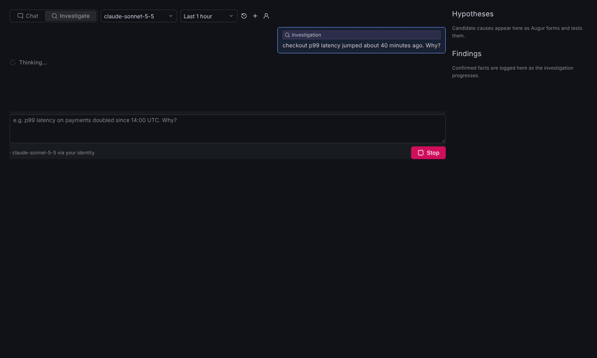
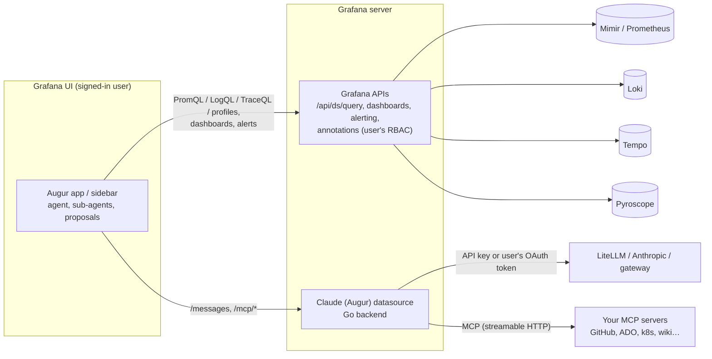
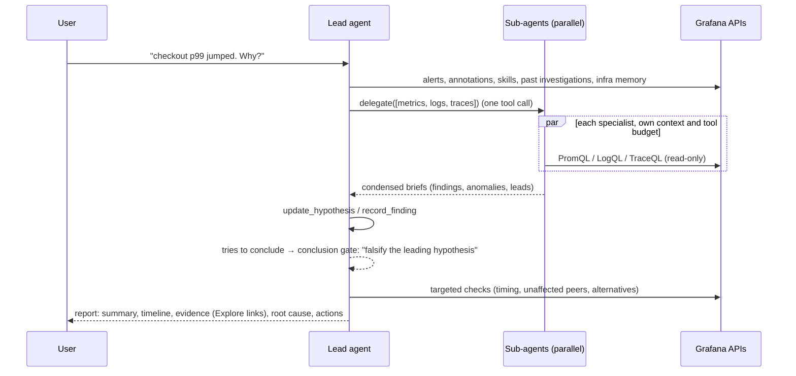

# Augur

**The self-hosted AI assistant for Grafana: your model, your network, no Grafana Cloud.**

Augur adds a Claude-powered observability engineer to self-hosted Grafana (OSS or Enterprise, **12.0+**). It runs entirely inside your Grafana and talks only to the model gateway you choose (LiteLLM, Bedrock behind a gateway, or the Anthropic API). There is no Grafana Cloud account, no third-party backend and no per-seat fee. It is docked on every page and can:

- **Chat** about your metrics, logs, traces, profiles, dashboards and alerts, with an Explore link behind every claim.
- **Investigate** incidents end to end: parallel specialist sub-agents work across Mimir/Prometheus, Loki, Tempo, Pyroscope, alert rules, state history and deploy annotations. A hypothesis board tracks candidate causes, and the leading one is deliberately challenged before Augur concludes. The result is a root-cause report you can save to Grafana.
- **Act, with your approval:** build new dashboards, edit existing ones, draft silences and alert rules. Queries are dry-run against real data first. Nothing changes until you click.
- **Use your team's knowledge:** org-wide **rules**, runbook **skills** (also runnable as `/commands`), an **infrastructure memory** of services and dependencies, past investigations, and your own tools through **MCP servers**.

Data queries run **as the signed-in user** through Grafana's own APIs, so Grafana RBAC applies. Model calls go through your gateway (LiteLLM, the Anthropic API, or any Claude Messages-compatible endpoint), using **either a gateway API key or each user's own OAuth/OIDC token** (e.g. Entra ID). Nothing leaves your network except the model call you configure.



<sub>The real Augur UI (Grafana UI components) running a scripted demo incident; see <a href="scripts/screenshots">scripts/screenshots</a>. More: <a href="docs/img/augur-investigation.png">full investigation report</a> · <a href="docs/img/augur-proposals.png">dashboard, alert-rule and silence proposals</a>.</sub>

## Quick start (Docker)

Try it locally with Grafana, Prometheus, Loki and Tempo preloaded with sample telemetry:

```bash
git clone https://github.com/AISolutionLabs/augur && cd augur
make install build                       # needs Node 22, Go and mage; or unzip the release zips into augur-*/dist
export ANTHROPIC_API_KEY=sk-ant-...      # or edit deploy/provisioning/datasources/augur.yaml for LiteLLM
docker compose -f deploy/docker-compose.yaml up
```

Open http://localhost:3000 (admin/admin) → **Augur** (top level of the menu), and ask *"What's the slowest service right now and why?"*

> Grafana is a trademark of Raintank, Inc. (Grafana Labs). Claude is a trademark of Anthropic, PBC. Augur is an independent open-source project, not affiliated with or endorsed by either.

---

## Augur and Grafana Assistant

Grafana Assistant is Grafana Labs' commercial agent. Since April 2026 OSS and Enterprise users can use it too, by connecting their Grafana to a Grafana Cloud stack: the stack provides the backend, limits and billing, and prompts plus query context are processed there. Its self-managed documentation requires Grafana 13.1+ and lists Investigations, investigation and Knowledge Graph memory, Automations and the Slack integration as *not available* ([docs](https://grafana.com/docs/grafana/latest/ai-tools/grafana-assistant/self-managed/), checked November 2026).

| Capability on self-managed Grafana | Grafana Assistant (on-prem) | Augur |
|---|---|---|
| Requires | Grafana 13.1+ and a Grafana Cloud stack | Grafana 12.0+ and a Claude-compatible model endpoint |
| Chat, query writing and explanation, navigation | ✓ | ✓ (with Explore/dashboard/alert links) |
| Create dashboards | ✓ | ✓ (queries dry-run before you see the draft) |
| Edit existing dashboards | ✓ | ✓ (change list, version-guarded apply, rollback via version history) |
| Rules and skills | ✓ | ✓ (also provisionable from Git; `/commands`) |
| MCP server integrations | ✓ | ✓ (proxied server-side; approval for non-read-only tools) |
| Investigations | ✗ (Cloud only) | ✓ (sub-agents, hypothesis board, challenge step, saved reports) |
| Infrastructure / knowledge memory | ✗ (Cloud only) | ✓ (scan of metrics/logs/traces + Tempo service graph) |
| Alerting actions | silences and routing (per Grafana Cloud guides) | draft silences (with live match preview) and alert rules |
| Profiles (Pyroscope) | not listed for self-managed | ✓ |
| Automations / scheduled runs, Slack | ✗ (Cloud only) | not yet (roadmap) |
| Where prompts and query context go | Grafana Cloud backend (stack region) ↔ LLM provider | your Grafana ↔ **your** gateway |
| Model / identity | Grafana-managed | your choice; per-user OAuth possible |
| Cost | Grafana Cloud Assistant pricing, per connected stack | open source (MIT) + your model usage |
| Benchmark | Grafana's [o11y-bench](https://o11ybench.ai/) | runs on o11y-bench with its own tools ([how](#benchmark)) |

Grafana Assistant has more polish and integrations inside Grafana Cloud. Augur is for teams that need the assistant to stay inside their own network and identity boundary.

---

## How it works



| Plugin | ID | Role |
|---|---|---|
| Augur app | `augur-assistant-app` | UI and agent: page and sidebar chat, investigations, proposal cards, settings (rules, skills, memory). Frontend only. |
| Claude (Augur) datasource | `augur-claude-datasource` | Go backend: Claude Messages proxy (credentials server-side, model allow-list, token cap) and the MCP client. |

There are two plugins because Grafana only forwards a user's OAuth token to *datasource* plugins.

### Tools the model can use

| Area | Tools |
|---|---|
| Discovery | `list_datasources`, `search_dashboards`, `get_dashboard`, `list_folders`, `get_infrastructure_memory` |
| Metrics | `prometheus_metric_names`, `prometheus_labels`, `query_prometheus` |
| Logs | `loki_labels`, `query_loki`, `loki_patterns` |
| Traces | `tempo_tag_values`, `search_traces`, `get_trace` |
| Profiles | `query_profiles` (Pyroscope: hottest functions by self/total) |
| Grafana | `run_panel_queries`, `list_alerts`, `alert_state_history`, `get_annotations`, `list_silences` |
| Knowledge | `search_skills`, `read_skill`, `search_past_investigations`, `read_past_investigation` |
| Investigation | `delegate` (parallel sub-agents), `update_hypothesis`, `record_finding` |
| Proposals (user applies) | `draft_dashboard`, `propose_dashboard_edit` (panels, variables, and query annotations such as deploy markers from logs), `draft_silence`, `draft_alert_rule` |
| MCP | `mcp__<server>__<tool>` for every tool your MCP servers expose |

### How investigations work



- **One lead agent orchestrates through tool calls.** `delegate` starts up to four specialist sub-agents at once. Each runs the same agent loop with its own fresh context, a read-only toolset, including MCP tools the server marks read-only (it can't propose changes, call tools that need approval, update hypotheses or delegate further), a 12-step budget, and a smaller context budget. Each returns a brief capped at about 6k characters, so the lead's context stays focused and the specialists can dig deep. Their tool calls appear live in the timeline, labelled `[metrics]`, `[logs]` and so on.
- **The board stays current.** After four rounds of queries with no new finding or hypothesis update, Augur is reminded to record what it has learned, so the board you watch, and what survives an interruption, stays up to date.
- **Hypotheses are explicit state.** Every candidate cause is tracked with a status (open, supported, refuted, confirmed), a confidence and its evidence. When the lead tries to finish, a **conclusion gate** sends it back once to falsify its leading hypothesis unless it has already done so.
- **Everything is grounded:** every claim in the report links to the query behind it.

### Context management

Raw Grafana responses never reach the model. Tools summarise in the browser before anything is sent:

| Signal | What the model sees |
|---|---|
| Metrics | Per-series min/max/avg/last, peak time and ~12 downsampled samples; top 25 series by peak |
| Logs | Newest lines, near-duplicates collapsed into `[N× similar]` groups (IDs, numbers and timestamps normalised), long lines clipped to 400 characters, stream summary |
| Traces | Services, span count, error spans with status messages, and the 12 slowest spans with key attributes, not the full span tree |
| Everything | Each tool result capped at ~14k characters, with a hint to narrow the query |

The conversation is kept under a **token budget** (140k by default, estimated conservatively). Older tool results are compacted in tiers: an excerpt first, then a one-line stub. The latest exchanges are always kept intact. If the gateway still reports *prompt too long*, Augur compacts harder and retries once. Prompt caching is applied to the system prompt, tools and latest turn.

### Durability

The agent runs in a module-level store, not inside a React component, so an investigation **keeps running when you close the sidebar or move around Grafana**. The page and the sidebar are two views of the same run. The transcript is **checkpointed after every step**. If the tab is reloaded, crashes, or the browser is closed mid-run, the session reopens with a **Resume** button that continues from the last checkpoint (unfinished tool calls are re-run as needed). Transient gateway failures (sleep or wake, 429, 5xx, overloaded) are retried with backoff, and the browser asks for confirmation before you close a tab with a run in progress. Only one tab drives a run at a time: other tabs see *Running in another tab* and take over automatically if that tab goes away (a 12-second lease). Runs still need an open Grafana tab; server-side scheduled runs are on the roadmap.

### Models

Augur is designed and evaluated with **Claude**. Its prompts, tool schemas and agent loop assume a model that is strong at multi-step tool use, and the default is `claude-sonnet-5-5`. You can still choose your gateway and model:

- **Claude Messages format (default):** the Anthropic API, LiteLLM `/v1/messages` (which can also route to Bedrock, Vertex or other providers behind your proxy), or any Messages-compatible gateway.
- **OpenAI-compatible format:** Chat Completions endpoints such as Azure OpenAI, vLLM, Ollama, OpenAI or LiteLLM `/v1/chat/completions`. The backend translates messages, tool calls and tool results in both directions, and sends the key as `Authorization`, `x-api-key` or `api-key` (Azure).

Smaller or open-weight models will run, but investigation quality depends heavily on how reliably they use tools.

---

## Install

Requires **Grafana 12.0 or later** (OSS or Enterprise). The same build runs on 12.x and 13.x.

1. Download `augur-assistant-app-<version>.zip` and `augur-claude-datasource-<version>.zip` from [Releases](https://github.com/AISolutionLabs/augur/releases), and unzip both into your plugins directory.
2. Allow the unsigned plugins, and put Augur at the top level of the menu (between Drilldown and Alerting; without this it sits under *More apps*, since plugins can't choose their own menu section):
   ```ini
   [plugins]
   allow_loading_unsigned_plugins = augur-assistant-app,augur-claude-datasource

   [navigation.app_sections]
   augur-assistant-app = root -3450
   ```
   With the Grafana Helm chart, put the same under `grafana.ini:` (`plugins:` / `navigation.app_sections:` keys). These must be in `grafana.ini`: `GF_*` environment variables cannot add `navigation.app_sections` entries. Other placements: `explore`, `alerts-and-incidents`, `observability`, `infrastructure`; a lower weight moves it up (Dashboards -3700, Explore -3600, Drilldown -3500, Alerting -3300).
3. Restart Grafana, enable the **Augur** app, and add a **Claude (Augur)** datasource.

The docked sidebar uses Grafana's extension sidebar. On Grafana versions without it, every entry point (panel menu, Explore, alerts, command palette) opens the full Augur page instead.

---

## Configure

### Claude datasource

| Setting | Notes |
|---|---|
| URL | e.g. `https://litellm.example.internal` or `https://api.anthropic.com` |
| API format | **Claude Messages** (default) or **OpenAI-compatible** (Chat Completions; Azure path and `?api-version=` go in *Messages path*) |
| Auth: **API key** | Encrypted. Sent as `Authorization: Bearer` (LiteLLM, OpenAI), `x-api-key` (Anthropic) or `api-key` (Azure). |
| Auth: **Forward OAuth token** | Each user's own access token or ID token. Requires Grafana login via OAuth/OIDC. |
| Models | **Discovered** from the endpoint's `/v1/models` with the caller's credentials (so a LiteLLM key or user token only sees its own models), optionally narrowed by a filter (`claude-*`). Requests for anything else are rejected server-side. Turn discovery off to use a fixed list. *Show models* previews what users will get. |
| TLS | **Add CA certificate** (PEM, encrypted) and/or a **CA bundle file** path (e.g. a mounted ConfigMap): trusted *in addition to* the system roots, for both the endpoint and MCP servers. Skip verification is available but not recommended. |
| MCP servers | Name, URL, auth (none / bearer / custom header / user's OAuth token), allowed-tool globs, read-only tool globs, role required for other tools, and approval policy. |

```yaml
apiVersion: 1
datasources:
  - name: Claude
    uid: claude
    type: augur-claude-datasource
    url: https://litellm.example.internal
    jsonData:
      authMethod: oauth            # or apiKey
      oauthPassThru: true
      oauthTokenType: access       # or id
      defaultModel: claude-sonnet-5-5
      allowedModels: ['claude-*']   # filter for the discovered list (modelDiscovery: off for a fixed list)
      tlsCACertFile: /etc/ssl/internal/ca.pem   # internal CA, mounted into the Grafana pod
      mcpServers:
        - name: github
          url: https://mcp.example.internal/github/mcp
          auth: bearer
          allowedTools: ['get_*', 'search_*', 'list_*', 'create_issue']
          readOnlyTools: ['get_*', 'search_*', 'list_*']   # admin decides what is read-only
          writeRole: Editor        # role needed for any other tool (Viewer | Editor | Admin)
        - name: ado
          url: https://mcp.example.internal/ado/mcp
          auth: oauth              # forwards the user's Entra token
          trustReadOnlyHints: true # only for servers you operate: trust their readOnlyHint
    secureJsonData:
      mcpToken_github: ${GITHUB_MCP_TOKEN}
```

**Internal CA on Kubernetes:** mount your CA bundle into the Grafana pod and point `tlsCACertFile` at it, instead of `tlsSkipVerify`. With the Grafana Helm chart:

```yaml
extraConfigmapMounts:
  - name: internal-ca
    configMap: internal-ca        # contains ca.pem
    mountPath: /etc/ssl/internal
    readOnly: true
```

Or paste the PEM into *Add CA certificate* (`jsonData.tlsAuthWithCACert: true` + `secureJsonData.tlsCACert`). Either way the system roots stay trusted, so public endpoints and MCP servers keep working. *Save & test* reports an unreadable or invalid CA.

**Forwarding Entra ID tokens to LiteLLM:** add your gateway's API scope to Grafana's OAuth scopes (`[auth.azuread] scopes = openid email profile offline_access api://<litellm-app-id>/.default`) so the access token's audience is the gateway. Alternatively, forward the ID token (its audience is Grafana's client ID). Then validate the token in LiteLLM against your tenant's JWKS and map its claims to teams. If no token is forwarded, requests fail with a clear 401; Augur never falls back to a shared key.

### Rules, skills and settings (app)

*Administration → Plugins → Augur → Augur settings* (org admins), or provision them from Git:

```yaml
apiVersion: 1
apps:
  - type: augur-assistant-app
    org_id: 1
    jsonData:
      investigationFolderUid: incident-reviews
      enableSubAgents: true
      rules:
        - { id: prod, scope: all, enabled: true, text: 'Production is the "Mimir prod" datasource; cluster label is k8s_cluster.' }
      skills:
        - name: kafka-lag
          title: Kafka consumer lag
          description: Use when consumer lag alerts fire
          enabled: true
          body: |
            1. Query kafka_consumergroup_lag by consumergroup and topic…
```

- **Rules** always apply. They can be scoped to chat, investigations or dashboards. Users can also add personal preferences, which are stored in their browser.
- **Skills** are Markdown runbooks. Augur finds them while working (`search_skills`), and users run them as `/kafka-lag orders-topic`. Import `.md` files with front matter (`name`, `title`, `description`, `tags`).
- **Infrastructure memory:** *Scan now* discovers services, namespaces and Tempo service-graph dependencies. It makes no model calls.

---

## Use it

- **Sidebar:** open Augur from Grafana's sidebar on any dashboard, Explore or alert page and ask "what's wrong here?". It knows the page you're on.
- **Panel menu:** *Ask Augur about this panel* / *Investigate with Augur*. **Explore toolbar:** *Ask Augur*. **Alert rules and instances:** *Investigate with Augur*. **Command palette:** *Ask Augur*.
- **Investigate** mode shows live hypotheses and findings. Finish with **Save to Grafana**, which saves a dashboard containing the report, findings, hypotheses, evidence panels and annotations, using your folder permissions. Or use **Export report** (Markdown). Saved investigations become searchable memory for future ones.
- **History:** previous conversations are available from the history menu, stored per browser.

### Permissions

| Action | Grafana permission needed (signed-in user) |
|---|---|
| Use Augur | Query the Claude (Augur) datasource |
| Query metrics/logs/traces/profiles | Query those datasources |
| Save new dashboards or saved investigations | Create in the target folder |
| Apply dashboard edits | Edit that dashboard |
| Create silences / alert rules | Alerting silence / rule create permissions (Editor by default) |
| Change org rules, skills, memory | Org admin |

---

## Security

- Credentials never reach the browser. Browser-supplied `Authorization`/`x-api-key` headers are never forwarded, and `extraHeaders` cannot override auth.
- The model cannot write anything itself. Dashboard, silence and alert changes are proposals that the user applies. Dashboard edits use Grafana's optimistic version check, so a concurrent change is never overwritten, and every save is restorable from version history.
- MCP authorization is enforced in the backend: only allow-listed tools that the server currently lists can be called, and only tools the **admin** marks read-only (`readOnlyTools`; servers' own `readOnlyHint` is ignored unless `trustReadOnlyHints` is set) skip the role check. Everything else requires the `writeRole` (default Editor) **and** an **Allow once** click in the UI. Sub-agents only get read-only tools.
- The backend never follows HTTP redirects, so credentials cannot be bounced to another host.
- Every data query is recorded in an **evidence ledger** (datasource, query, absolute time range, SHA-256 digest of the response, frame/row counts). Findings cite evidence ids (`E3`), and the ledger is saved with investigations and reports.
- A per-run token ceiling (default 1.5M, configurable) stops runaway loops; the run then answers from what it has.
- Tool output (logs, dashboards, annotations, MCP results) is treated as untrusted data, never as instructions. This is a mitigation, not a guarantee; the structural controls above are what limit the impact of prompt injection.
- With OAuth forwarding, Augur forwards the user's token; your gateway and MCP servers must validate issuer, audience and expiry.
- The backend accepts a fixed set of Messages API fields and enforces the model allow-list, `max_tokens` cap and request/response size limits.
- Conversations and run checkpoints are stored only in the user's browser (localStorage). Saved investigations are ordinary Grafana dashboards, governed by folder permissions.

See [SECURITY.md](SECURITY.md) for the full trust model and how to report a vulnerability.

---

## Headless runner

The same agent, tools and prompts can run outside the browser, against Grafana's HTTP API with a service-account token. It is used for the end-to-end tests and the benchmark, and works for scripted checks too:

```bash
cd augur-app && npm run build:headless
GRAFANA_URL=https://grafana.example.com GRAFANA_TOKEN=glsa_... \
MODEL_BASE_URL=https://litellm.example.internal MODEL_API_KEY=sk-... MODEL=claude-sonnet-5-5 \
node dist-headless/augur-headless.mjs "Which service has the highest error rate in the last hour?"
```

| Variable | Meaning |
|---|---|
| `GRAFANA_URL`, `GRAFANA_TOKEN` (or `GRAFANA_USER`/`GRAFANA_PASSWORD`) | Grafana and the identity whose permissions apply |
| `AUGUR_DATASOURCE_UID` | Call the model through an Augur datasource (its key/OAuth and guardrails), *or* |
| `MODEL_BASE_URL`, `MODEL_API_KEY`, `MODEL` | a Claude Messages endpoint directly (`/v1/messages` is appended); `MODEL_AUTH_HEADER=x-api-key` for Anthropic |
| `AUGUR_MODE` | `chat` (default) or `investigate` (sub-agents, hypotheses, conclusion gate) |
| `AUGUR_APPLY=auto` | Apply proposals automatically. **Off by default**; meant for unattended tests and benchmarks |
| `AUGUR_TRAJECTORY`, `AUGUR_ANSWER` | Write the run as an ATIF trajectory (tool calls, results, evidence, usage) and the final answer |
| `AUGUR_NOW` | Fixed "current time" for reproducible runs |

## Testing

- **Unit and UI tests** (`make test`): the agent and tools against a fake Grafana API; `ChatPage.test.tsx` drives the whole UI with a scripted model; Go tests cover both auth modes, the guardrails and an MCP server over JSON and SSE.
- **End to end** (`make e2e`, and the [E2E workflow](.github/workflows/e2e.yml) on every push): a real Grafana 13 with Prometheus, Loki and Tempo preloaded with incident data (the o11y-bench stack), the plugins built from the commit, and a scripted stub model ([`e2e/`](e2e)). It checks that both plugins load and the datasource backend is healthy, then runs the headless agent twice (model called directly and through the datasource backend), asserting real query results, evidence ids, and a dashboard with panels and a Loki annotation saved in Grafana. Finally it opens the app in Chrome, sends a message and checks the run completes with a draft card and no errors. No model key is needed.

## Benchmark

[o11y-bench](https://github.com/grafana/o11y-bench) is Grafana Labs' open benchmark for observability agents: 64 tasks across PromQL, LogQL, TraceQL, Grafana API, dashboarding and incident investigation, graded on Grafana state and by a Claude judge. [`bench/o11y-bench`](bench/o11y-bench) runs Augur on it as a Harbor agent (Augur's own tools, not mcp-grafana) and, for comparison, the benchmark's default agent with the same model:

```bash
export ANTHROPIC_API_KEY=...                       # also used by the grader's judge
export ANTHROPIC_BASE_URL=https://litellm.example  # optional: your gateway's /v1/messages
bench/o11y-bench/run.sh anthropic/claude-sonnet-5-5 --task-name query-cpu-metrics --n-concurrent 1   # one task first
bench/o11y-bench/run.sh anthropic/claude-sonnet-5-5                                                  # full run
```

Needs Docker, [mise](https://mise.jdx.dev/) and [uv](https://docs.astral.sh/uv/). Add `--ak mode=investigate` for investigation mode. Reports land in `bench/.o11y-bench/jobs/*/run_report.html`. Proposals are applied automatically in the benchmark, because dashboard tasks are graded on what is saved.

---

## Development

```
augur-app/          # app plugin (React/TS): src/agent (agent, tools), src/session, src/components
augur-datasource/   # datasource plugin (Go backend: Messages proxy + MCP client; config editor)
deploy/             # docker-compose demo with grafana/otel-lgtm
```

```bash
make install && make lint && make test && make package
```

The agent is UI-independent: tools take a `ToolContext` with an HTTP abstraction, which is why the same code runs in the app, the headless runner and the tests.

### Releasing

Releases are built and published by GitHub Actions ([`release.yml`](.github/workflows/release.yml)):

- **One click:** *Actions → Release → Run workflow*, enter a version (e.g. `1.2.0`, or `1.2.0-rc.1` for a pre-release). The workflow bumps both plugins, commits, tags `v1.2.0` and releases.
- **Or tag it yourself:** `git tag v1.2.0 && git push origin v1.2.0`.

Each release runs lint, tests, the Grafana 12.0 compatibility check and the full build (Go backends for Linux, macOS and Windows). It optionally signs the plugins, checks the archive layout, runs Grafana's plugin validator (advisory), and publishes both zips plus `SHA256SUMS` to GitHub Releases, with notes from the CHANGELOGs and build-provenance attestations (`gh attestation verify <zip> --repo AISolutionLabs/augur`). Add a `## <version>` section to both CHANGELOGs before releasing.

To sign, add the repository secret `GRAFANA_ACCESS_POLICY_TOKEN`. For a private signature, also add the variable `GRAFANA_SIGN_ROOT_URLS` (e.g. `https://grafana.example.com`). Without the secret, unsigned builds are published.

**Screenshots:** `cd scripts/screenshots && npm i && node build.mjs && node shoot.mjs` renders the real components with `@grafana/ui` against a scripted demo incident in headless Chrome and regenerates `docs/img`.

**Signing:** `npx @grafana/sign-plugin@latest --rootUrls https://grafana.example.com` (private signing), or allow the unsigned plugins with `allow_loading_unsigned_plugins`.

**Roadmap:** server-side runner for scheduled automations, alert-triggered and cross-device investigations; Slack; dashboard v2 schema editing; streaming responses.

## License

[MIT](LICENSE)
