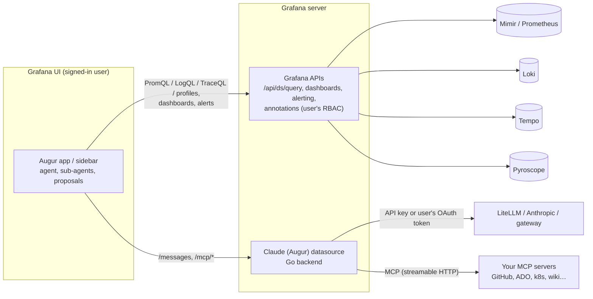

# Augur

**AI investigations for Grafana, powered by Claude.**

Augur adds a Claude-powered observability engineer to self-hosted Grafana (OSS or Enterprise, **12.0+**). It is docked on every page and can:

- **Chat** about your metrics, logs, traces, profiles, dashboards and alerts, with an Explore link behind every claim.
- **Investigate** incidents end to end: parallel specialist sub-agents work across Mimir/Prometheus, Loki, Tempo, Pyroscope, alert rules, state history and deploy annotations. A hypothesis board tracks candidate causes, and the leading one is deliberately challenged before Augur concludes. The result is a root-cause report you can save to Grafana.
- **Act, with your approval:** build new dashboards, edit existing ones, draft silences and alert rules. Queries are dry-run against real data first. Nothing changes until you click.
- **Use your team's knowledge:** org-wide **rules**, runbook **skills** (also runnable as `/commands`), an **infrastructure memory** of services and dependencies, past investigations, and your own tools through **MCP servers**.

Data queries run **as the signed-in user** through Grafana's own APIs, so Grafana RBAC applies. Model calls go through your gateway (LiteLLM, the Anthropic API, or any Claude Messages-compatible endpoint), using **either a gateway API key or each user's own OAuth/OIDC token** (e.g. Entra ID). Nothing leaves your network except the model call you configure.

> Grafana is a trademark of Raintank, Inc. (Grafana Labs). Claude is a trademark of Anthropic, PBC. Augur is an independent open-source project, not affiliated with or endorsed by either.

---

## Augur and Grafana Assistant

Grafana Assistant is Grafana Labs' commercial agent. On self-managed Grafana it runs through a Grafana Cloud stack, which provides its backend, limits and billing. Grafana's documentation lists Investigations, infrastructure memory, Automations and the Slack integration as *not available* on self-managed Grafana ([docs](https://grafana.com/docs/grafana/latest/ai-tools/grafana-assistant/self-managed/)).

| Capability on self-managed Grafana | Grafana Assistant (on-prem) | Augur |
|---|---|---|
| Chat, query writing and explanation, navigation | ✓ | ✓ (with Explore/dashboard/alert links) |
| Create dashboards | ✓ | ✓ (queries dry-run before you see the draft) |
| Edit existing dashboards | ✓ | ✓ (change list, version-guarded apply, rollback via version history) |
| Rules and skills | ✓ | ✓ (also provisionable from Git; `/commands`) |
| MCP server integrations | ✓ | ✓ (proxied server-side; approval for non-read-only tools) |
| Investigations | ✗ (Cloud only) | ✓ (sub-agents, hypothesis board, challenge step, saved reports) |
| Infrastructure memory | ✗ (Cloud only) | ✓ (scan of metrics/logs/traces + Tempo service graph) |
| Alerting actions | silences and routing (per Grafana Cloud guides) | draft silences (with live match preview) and alert rules |
| Profiles (Pyroscope) | not listed for self-managed | ✓ |
| Automations / scheduled runs, Slack | ✗ (Cloud only) | not yet (roadmap) |
| Where data and prompts go | your Grafana ↔ Grafana Cloud ↔ LLM provider | your Grafana ↔ **your** gateway |
| Model / identity | Grafana-managed | your choice; per-user OAuth possible |
| Cost | per-user Grafana Cloud pricing | open source (MIT) + your model usage |

Grafana Assistant has more polish and integrations inside Grafana Cloud. Augur aims to make self-hosted Grafana self-sufficient.

---

## How it works



| Plugin | ID | Role |
|---|---|---|
| Augur app | `augur-assistant-app` | UI and agent: page and sidebar chat, investigations, proposal cards, settings (rules, skills, memory). Frontend only. |
| Claude (Augur) datasource | `augur-claude-datasource` | Go backend: Claude Messages proxy (credentials server-side, model allow-list, token cap) and the MCP client. |

There are two plugins because Grafana only forwards a user's OAuth token to *datasource* plugins.

### Tools the model can use

| Area | Tools |
|---|---|
| Discovery | `list_datasources`, `search_dashboards`, `get_dashboard`, `list_folders`, `get_infrastructure_memory` |
| Metrics | `prometheus_metric_names`, `prometheus_labels`, `query_prometheus` |
| Logs | `loki_labels`, `query_loki`, `loki_patterns` |
| Traces | `tempo_tag_values`, `search_traces`, `get_trace` |
| Profiles | `query_profiles` (Pyroscope: hottest functions by self/total) |
| Grafana | `run_panel_queries`, `list_alerts`, `alert_state_history`, `get_annotations`, `list_silences` |
| Knowledge | `search_skills`, `read_skill`, `search_past_investigations`, `read_past_investigation` |
| Investigation | `delegate` (parallel sub-agents), `update_hypothesis`, `record_finding` |
| Proposals (user applies) | `draft_dashboard`, `propose_dashboard_edit`, `draft_silence`, `draft_alert_rule` |
| MCP | `mcp__<server>__<tool>` for every tool your MCP servers expose |

---

## Install

Requires **Grafana 12.0 or later** (OSS or Enterprise). The same build runs on 12.x and 13.x.

1. Download `augur-assistant-app-<version>.zip` and `augur-claude-datasource-<version>.zip` from [Releases](https://github.com/AISolutionLabs/augur/releases), and unzip both into your plugins directory.
2. Until signed, allow them:
   ```ini
   [plugins]
   allow_loading_unsigned_plugins = augur-assistant-app,augur-claude-datasource
   ```
3. Restart Grafana, enable the **Augur** app, and add a **Claude (Augur)** datasource.

The docked sidebar uses Grafana's extension sidebar. On Grafana versions without it, every entry point (panel menu, Explore, alerts, command palette) opens the full Augur page instead.

**Local demo:** `make build && export ANTHROPIC_API_KEY=… && docker compose -f deploy/docker-compose.yaml up`, then open http://localhost:3000 (admin/admin). This runs `grafana/otel-lgtm` with sample telemetry.

---

## Configure

### Claude datasource

| Setting | Notes |
|---|---|
| URL | e.g. `https://litellm.example.internal` or `https://api.anthropic.com` |
| Auth: **API key** | Encrypted. Sent as `Authorization: Bearer` (LiteLLM) or `x-api-key` (Anthropic). |
| Auth: **Forward OAuth token** | Each user's own access token or ID token. Requires Grafana login via OAuth/OIDC. |
| Models | Default and allowed models; anything else is rejected server-side. |
| MCP servers | Name, URL, auth (none / bearer / custom header / user's OAuth token), allowed-tool globs, and approval policy. |

```yaml
apiVersion: 1
datasources:
  - name: Claude
    uid: claude
    type: augur-claude-datasource
    url: https://litellm.example.internal
    jsonData:
      authMethod: oauth            # or apiKey
      oauthPassThru: true
      oauthTokenType: access       # or id
      defaultModel: claude-sonnet-5-5
      allowedModels: [claude-opus-5-5, claude-haiku-5-5]
      mcpServers:
        - name: github
          url: https://mcp.example.internal/github/mcp
          auth: bearer
          allowedTools: ['get_*', 'search_*', 'list_*']
        - name: ado
          url: https://mcp.example.internal/ado/mcp
          auth: oauth              # forwards the user's Entra token
    secureJsonData:
      mcpToken_github: ${GITHUB_MCP_TOKEN}
```

**Forwarding Entra ID tokens to LiteLLM:** add your gateway's API scope to Grafana's OAuth scopes (`[auth.azuread] scopes = openid email profile offline_access api://<litellm-app-id>/.default`) so the access token's audience is the gateway. Alternatively, forward the ID token (its audience is Grafana's client ID). Then validate the token in LiteLLM against your tenant's JWKS and map its claims to teams. If no token is forwarded, requests fail with a clear 401; Augur never falls back to a shared key.

### Rules, skills and settings (app)

*Administration → Plugins → Augur → Augur settings* (org admins), or provision them from Git:

```yaml
apiVersion: 1
apps:
  - type: augur-assistant-app
    org_id: 1
    jsonData:
      investigationFolderUid: incident-reviews
      enableSubAgents: true
      rules:
        - { id: prod, scope: all, enabled: true, text: 'Production is the "Mimir prod" datasource; cluster label is k8s_cluster.' }
      skills:
        - name: kafka-lag
          title: Kafka consumer lag
          description: Use when consumer lag alerts fire
          enabled: true
          body: |
            1. Query kafka_consumergroup_lag by consumergroup and topic…
```

- **Rules** always apply. They can be scoped to chat, investigations or dashboards. Users can also add personal preferences, which are stored in their browser.
- **Skills** are Markdown runbooks. Augur finds them while working (`search_skills`), and users run them as `/kafka-lag orders-topic`. Import `.md` files with front matter (`name`, `title`, `description`, `tags`).
- **Infrastructure memory:** *Scan now* discovers services, namespaces and Tempo service-graph dependencies. It makes no model calls.

---

## Use it

- **Sidebar:** open Augur from Grafana's sidebar on any dashboard, Explore or alert page and ask "what's wrong here?". It knows the page you're on.
- **Panel menu:** *Ask Augur about this panel* / *Investigate with Augur*. **Explore toolbar:** *Ask Augur*. **Alert rules and instances:** *Investigate with Augur*. **Command palette:** *Ask Augur*.
- **Investigate** mode shows live hypotheses and findings. Finish with **Save to Grafana**, which saves a dashboard containing the report, findings, hypotheses, evidence panels and annotations, using your folder permissions. Or use **Export report** (Markdown). Saved investigations become searchable memory for future ones.
- **History:** previous conversations are available from the history menu, stored per browser.

### Permissions

| Action | Grafana permission needed (signed-in user) |
|---|---|
| Use Augur | Query the Claude (Augur) datasource |
| Query metrics/logs/traces/profiles | Query those datasources |
| Save new dashboards or saved investigations | Create in the target folder |
| Apply dashboard edits | Edit that dashboard |
| Create silences / alert rules | Alerting silence / rule create permissions (Editor by default) |
| Change org rules, skills, memory | Org admin |

---

## Security

- Credentials never reach the browser. Browser-supplied `Authorization`/`x-api-key` headers are never forwarded, and `extraHeaders` cannot override auth.
- The model cannot write anything itself. Dashboard, silence and alert changes are proposals that the user applies. Dashboard edits use Grafana's optimistic version check, so a concurrent change is never overwritten, and every save is restorable from version history.
- MCP tools not annotated read-only require an explicit **Allow once** from the user. Admins can restrict tools per server with globs.
- Tool output (logs, dashboards, annotations, MCP results) is treated as untrusted data, never as instructions.
- The backend accepts a fixed set of Messages API fields and enforces the model allow-list, `max_tokens` cap and request/response size limits.
- Conversations are stored only in the user's browser. Saved investigations are ordinary Grafana dashboards, governed by folder permissions.

---

## Development

```
augur-app/          # app plugin (React/TS): src/agent (agent, tools), src/session, src/components
augur-datasource/   # datasource plugin (Go backend: Messages proxy + MCP client; config editor)
deploy/             # docker-compose demo with grafana/otel-lgtm
```

```bash
make install && make lint && make test && make package
```

The agent is UI-independent: tools take a `ToolContext` with an HTTP abstraction and are unit-tested against a fake Grafana API. `ChatPage.test.tsx` drives the whole UI with a scripted model (investigations, proposals, MCP approvals, history, sidebar). The Go tests cover both auth modes, the guardrails and an MCP server over JSON and SSE.

### Releasing

Releases are built and published by GitHub Actions ([`release.yml`](.github/workflows/release.yml)):

- **One click:** *Actions → Release → Run workflow*, enter a version (e.g. `1.2.0`, or `1.2.0-rc.1` for a pre-release). The workflow bumps both plugins, commits, tags `v1.2.0` and releases.
- **Or tag it yourself:** `git tag v1.2.0 && git push origin v1.2.0`.

Each release runs lint, tests, the Grafana 12.0 compatibility check and the full build (Go backends for Linux, macOS and Windows). It optionally signs the plugins, checks the archive layout, runs Grafana's plugin validator (advisory), and publishes both zips plus `SHA256SUMS` to GitHub Releases, with notes from the CHANGELOGs and build-provenance attestations (`gh attestation verify <zip> --repo AISolutionLabs/augur`). Add a `## <version>` section to both CHANGELOGs before releasing.

To sign, add the repository secret `GRAFANA_ACCESS_POLICY_TOKEN`. For a private signature, also add the variable `GRAFANA_SIGN_ROOT_URLS` (e.g. `https://grafana.example.com`). Without the secret, unsigned builds are published.

**Signing:** `npx @grafana/sign-plugin@latest --rootUrls https://grafana.example.com` (private signing). Community signing requires the ID prefix (`augur-`) to match your grafana.com org slug.

**Roadmap:** scheduled automations and alert-triggered investigations (server-side runner), Slack, dashboard v2 schema editing, streaming responses.

## License

[MIT](LICENSE)
