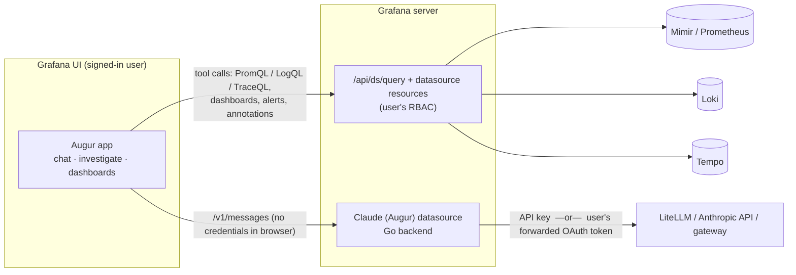

# Augur

**AI investigations for Grafana, powered by Claude.**

Augur adds a Claude-powered assistant inside Grafana OSS and Enterprise. Use it to:

- **Chat** about your metrics, logs, traces, dashboards and alerts.
- **Investigate** incidents: Augur works through Mimir/Prometheus, Loki, Tempo, alert rules, alert state history and annotations, correlates what it finds, and writes a root-cause report with evidence.
- **Build dashboards** from a description or from an investigation. Each query is dry-run against your data first, and nothing is saved until you click **Save**.

Everything runs inside your Grafana. Telemetry queries run **as the signed-in user** through Grafana's own query API, so Grafana RBAC still applies. Model calls go through your own gateway (LiteLLM, the Anthropic API, or any Claude Messages-compatible endpoint), authenticated with **either a gateway API key or each user's own OAuth/OIDC token** (e.g. Entra ID).

> Grafana is a trademark of Raintank, Inc. (Grafana Labs). Claude is a trademark of Anthropic, PBC. Augur is an independent open-source project and is not affiliated with or endorsed by either company.

---

## How it works



The project ships two plugins, because Grafana only forwards a user's OAuth token to **datasource** plugins:

| Plugin | ID | What it does |
|---|---|---|
| Augur app | `augur-assistant-app` | The UI and the agent: chat, the investigation timeline, the findings panel, dashboard drafts, report export, and panel-menu / alert / command-palette entry points. Frontend only. |
| Claude (Augur) datasource | `augur-claude-datasource` | A small Go proxy for the Claude Messages API. It adds credentials server-side, enforces a model allow-list and output-token cap, and attributes usage (`metadata.user_id`). |

### Tools available to the model

Every tool is read-only except dashboard drafting, and a draft is only saved when the user clicks Save.

| Area | Tools |
|---|---|
| Discovery | `list_datasources`, `search_dashboards`, `get_dashboard`, `list_folders` |
| Metrics (Prometheus/Mimir/Thanos/Cortex) | `prometheus_metric_names`, `prometheus_labels`, `query_prometheus` |
| Logs (Loki) | `loki_labels`, `query_loki` (log and metric queries), `loki_patterns` |
| Traces (Tempo) | `tempo_tag_values`, `search_traces` (TraceQL), `get_trace` (error and slowest spans) |
| Grafana | `run_panel_queries` (reuse curated panel queries with variables resolved), `list_alerts`, `alert_state_history`, `get_annotations` |
| Investigation | `record_finding` (populates the live findings panel) |
| Dashboards | `draft_dashboard` (spec → valid JSON, grid layout, variables, query dry-run) |

Results are summarised before they reach the model (series stats, peak times, downsampled samples, newest log lines, span summaries) and capped in size. Older tool output is compacted in long investigations, and prompt caching is applied automatically.

---

## Install

Requires **Grafana 13.0+** (OSS or Enterprise).

### From a release

1. Download `augur-assistant-app-<version>.zip` and `augur-claude-datasource-<version>.zip` from [Releases](https://github.com/AISolutionLabs/augur/releases).
2. Unzip both into your Grafana plugins directory (e.g. `/var/lib/grafana/plugins`).
3. Until the plugins are signed, allow them to load unsigned:
   ```ini
   [plugins]
   allow_loading_unsigned_plugins = augur-assistant-app,augur-claude-datasource
   ```
   or set `GF_PLUGINS_ALLOW_LOADING_UNSIGNED_PLUGINS=augur-assistant-app,augur-claude-datasource`.
4. Restart Grafana, then enable the **Augur** app under *Administration → Plugins*.

On Kubernetes with the Grafana Helm chart, either use `plugins:` with the release zip URLs, or bake both plugins into your image.

### Try it locally (with a demo LGTM stack)

```bash
make build                      # builds both plugins into */dist
export ANTHROPIC_API_KEY=sk-ant-...   # or point the datasource at your LiteLLM
docker compose -f deploy/docker-compose.yaml up
```

Then open http://localhost:3000 (admin/admin) → **Augur**. The compose file uses `grafana/otel-lgtm`, which provides Grafana, Prometheus, Loki and Tempo with sample telemetry already provisioned.

---

## Configure the Claude datasource

*Connections → Data sources → Add → Claude (Augur).*

| Setting | Notes |
|---|---|
| URL | Base URL of the gateway, e.g. `https://litellm.example.internal` or `https://api.anthropic.com` |
| Messages / Models path | Defaults `/v1/messages`, `/v1/models` (both supported by LiteLLM and Anthropic) |
| Auth: **API key** | Stored encrypted. Sent as `Authorization: Bearer` (LiteLLM virtual keys) or `x-api-key` (Anthropic). |
| Auth: **Forward OAuth token** | Sends each signed-in user's own **access token** or **ID token**. Requires Grafana login via OAuth/OIDC. |
| Default / allowed models | Model names as your gateway knows them. Users can choose among them; anything else is rejected server-side. |
| Max output tokens, timeout | Server-side caps |

### Provisioning

```yaml
apiVersion: 1
datasources:
  # Shared gateway key
  - name: Claude
    uid: claude
    type: augur-claude-datasource
    url: https://litellm.example.internal
    jsonData:
      authMethod: apiKey
      apiKeyHeader: authorization     # or x-api-key for api.anthropic.com
      defaultModel: claude-sonnet-5-5
      allowedModels: [claude-opus-5-5, claude-haiku-5-5]
      maxTokens: 8192
    secureJsonData:
      apiKey: ${LITELLM_API_KEY}

  # Per-user identity (Entra ID / any OIDC)
  - name: Claude (my identity)
    uid: claude-oauth
    type: augur-claude-datasource
    url: https://litellm.example.internal
    jsonData:
      authMethod: oauth
      oauthPassThru: true            # Grafana's flag to forward the user's token
      oauthTokenType: access         # or id
      defaultModel: claude-sonnet-5-5
```

### Forwarding Entra ID tokens to LiteLLM

With OAuth forwarding, your gateway sees the real user, so per-user and per-team routing, budgets and audit logs work unchanged.

1. Sign in to Grafana with Entra ID (`[auth.azuread]`).
2. Pick which token to forward:
   - **Access token (recommended):** Grafana requests Graph-scoped tokens by default, so add your gateway's API scope to Grafana's OAuth scopes so that the access token's `aud` is your gateway:
     ```ini
     [auth.azuread]
     scopes = openid email profile offline_access api://<litellm-app-id>/.default
     ```
     (Entra issues a token for a single resource per request; if you depend on Graph-scoped features in Grafana, use the ID token instead.)
   - **ID token:** `aud` is Grafana's own client ID. Configure the gateway's JWT validation to accept that audience.
3. In LiteLLM, validate the JWT against your tenant's JWKS (`JWT_PUBLIC_KEY_URL` / custom auth) and map claims (`oid`, `groups`, `roles`) to users and teams.

If no token is forwarded (a local-login user, or forwarding switched off), the request fails with a clear 401. Augur never falls back to a shared key.

---

## Use it

- **Nav → Augur.** Pick **Chat** or **Investigate**, a time range, and (if allowed) a model.
- **Panel menu → Extensions → *Ask Claude about this panel* / *Investigate with Claude*.** Opens Augur with the panel's queries, dashboard and time range as context.
- **Alert rule / alert instance actions → *Investigate with Claude*.**
- **Command palette (Ctrl/Cmd+K) → *Ask Claude*.**

**Investigate** runs a structured method (scope → discover → golden signals vs. baseline → logs → traces → correlate → falsify hypotheses), records findings live, and ends with a report: Summary, Timeline, Evidence (with queries), Root cause, Impact, Recommended actions, Open questions. **Export report** downloads the report as Markdown, together with the findings log and every query that was run.

**Dashboards:** e.g. *"Build a RED dashboard for checkout with error logs and slow traces, variables for namespace and pod"*, or *"Turn this investigation into a dashboard"*. You get a draft card showing the layout, warnings, and which queries returned data. Choose a folder and click **Save as new dashboard**. Augur never overwrites an existing dashboard; extending one creates a copy.

### Permissions

| Action | Grafana permission the user needs |
|---|---|
| Use Augur | Query permission on the Claude (Augur) datasource |
| Query metrics/logs/traces | Query permission on those datasources |
| Read dashboards, alerts, annotations | Normal read access; anything the user can't see, Augur can't see |
| Save a drafted dashboard | Create permission in the chosen folder |

---

## Security notes

- Credentials never reach the browser. API keys are stored in `secureJsonData` and added by the Go backend, and browser-supplied `Authorization`/`x-api-key` headers are never forwarded. `extraHeaders` cannot override auth headers.
- The backend only accepts a fixed set of Messages API fields, enforces the model allow-list and `max_tokens` cap, disables streaming, and limits request (8 MiB) and response (16 MiB) sizes.
- Tool output (log lines, dashboard text, annotations) is passed to the model as untrusted data, and the system prompt tells the model never to follow instructions found there. The tools themselves are read-only, so the worst a prompt-injection can do is cause extra read queries or a dashboard *draft*.
- Conversation state is kept in the browser tab's `sessionStorage` only. Augur adds no server-side storage.

---

## Development

```
augur-app/          # app plugin (React/TypeScript), the agent lives in src/agent
augur-datasource/   # datasource plugin (Go backend + config editor)
deploy/             # docker-compose demo with grafana/otel-lgtm
```

```bash
make install   # npm ci in both packages
make test      # jest (app + datasource) and go test
make lint      # tsc + eslint
make build     # frontend bundles + Go binaries for all platforms (needs mage)
make package   # dist zips under ./release
```

The agent is UI-independent (`src/agent/*`): tools take a `ToolContext` with an HTTP abstraction, so they are unit-tested against a fake Grafana API. `ChatPage.test.tsx` drives the full UI with a scripted model.

### Signing

To use the plugins without `allow_loading_unsigned_plugins`, sign them with a Grafana Cloud access policy token (`npx @grafana/sign-plugin@latest --rootUrls https://grafana.example.com` for private signing). The plugin ID prefix (`augur-`) must match your grafana.com org slug for community signing; otherwise rename the IDs.

## License

[MIT](LICENSE)
