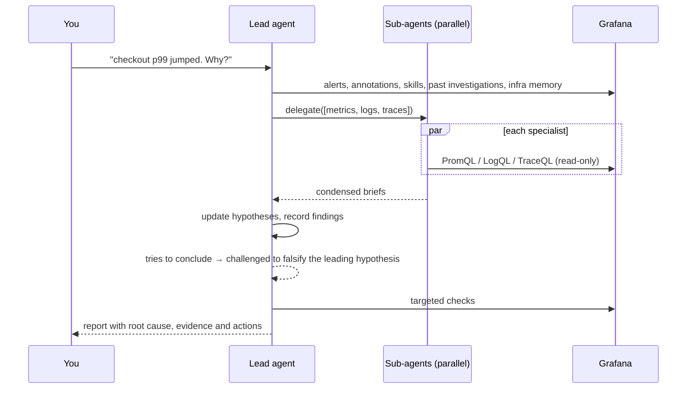

# Investigations

Switch the header to **Investigate**, or use *Investigate with Augur* from a panel or alert, and describe the symptom.

## What you see

- **Timeline:** every query as it runs, labelled by sub-agent (`[metrics]`, `[logs]`, `[traces]`), with results you can expand.
- **Hypothesis board:** candidate causes with status (**open**, **supported**, **refuted**, **confirmed**), confidence, and whether the hypothesis was challenged.
- **Findings:** facts recorded along the way, by severity, each citing its evidence (`E3`).
- **Report:** summary, timeline, evidence with Explore links, root cause, and recommended actions.

## How it works

- **Sub-agents.** The lead agent can start up to four specialists at once. Each has its own context, a read-only toolset, a 12-step budget, and returns a brief of about 6k characters, so the lead stays focused while specialists dig deep.
- **Hypotheses are explicit.** Every candidate cause is tracked with evidence. When the lead tries to finish, a **conclusion gate** sends it back once to try to disprove its leading hypothesis (timing, unaffected peers, alternatives), unless it already did.
- **The board stays current.** After four rounds of queries with nothing recorded, Augur is reminded to update findings and hypotheses, so what you see, and what survives an interruption, is up to date.
- **Evidence ledger.** Every data query is recorded with the datasource, query, absolute time range, a SHA-256 digest of the response, and frame/row counts. Findings cite ledger ids.

## Context Augur starts from

- Firing alerts and recent annotations (deploys)
- Your org's rules and matching skills
- [Infrastructure memory](../configure/app-settings.md#infrastructure-memory): services and dependencies
- Similar past investigations
- [Installed apps and plugins](../reference/tools.md#knowing-your-grafana)

## Finishing

- **Save to Grafana** creates a dashboard with the report, findings, hypotheses, evidence panels and annotations, in the investigations folder (your folder permissions apply). Saved investigations are searchable in future ones.
- **Markdown** and **PDF** export the report. See [Reports and export](reports.md).

## Tips

- Give a start time if you know it: *"since 14:20 UTC"*.
- Say what's normal: *"usually 200ms"*.
- If Augur goes down a wrong path, stop and redirect: *"Ignore the DB; the problem started before the migration."*
