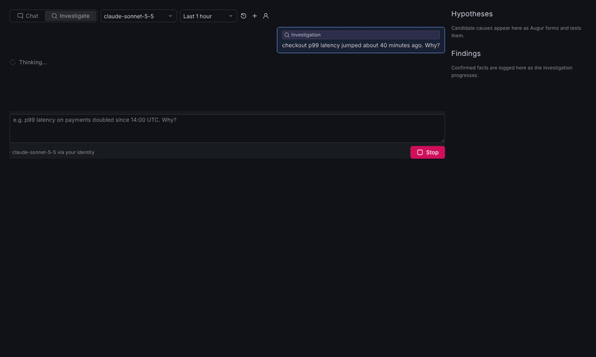
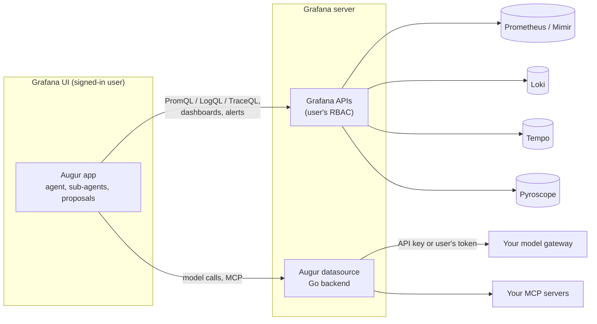

---
hide:
  - navigation
---

# Augur

**The self-hosted AI assistant for Grafana: your model, your network, no Grafana Cloud.**

Augur adds an AI observability engineer to self-hosted Grafana (OSS or Enterprise, **12.0+**). It runs inside your Grafana and talks only to the model endpoint you choose: LiteLLM, the Anthropic API, Bedrock behind a gateway, or an OpenAI-compatible endpoint. There's no Grafana Cloud account, no third-party backend and no per-seat fee.

[Quick start :material-rocket-launch:](getting-started/quick-start.md){ .md-button .md-button--primary }
[Install in your Grafana](getting-started/install.md){ .md-button }

## What it does

-   :material-chat-question: **Chat about your telemetry**

    ---

    Ask about metrics, logs, traces, profiles, dashboards and alerts. Every claim links to the Explore query behind it. Augur knows the page you're on.

    [:octicons-arrow-right-24: Chat](guide/chat.md)

-   :material-magnify-scan: **Investigate incidents**

    ---

    Parallel sub-agents search Prometheus/Mimir, Loki, Tempo and Pyroscope. A hypothesis board tracks causes, and the leading one is challenged before Augur concludes.

    [:octicons-arrow-right-24: Investigations](guide/investigations.md)

-   :material-view-dashboard-edit: **Build dashboards**

    ---

    Describe a dashboard and get a modern one with a live preview on real data, automatic query fixes, and revisions you ask for in plain language.

    [:octicons-arrow-right-24: Dashboards](guide/dashboards.md)

-   :material-shield-check: **Act only with your approval**

    ---

    Dashboard edits, silences and alert rules are proposals. Nothing changes until you click, and it uses your own Grafana permissions.

    [:octicons-arrow-right-24: Security model](operate/security.md)

-   :material-book-open-variant: **Use your team's knowledge**

    ---

    Org-wide rules, runbook skills (`/commands`), an infrastructure memory, past investigations, and your own tools through MCP servers.

    [:octicons-arrow-right-24: Rules, skills and memory](configure/app-settings.md)

-   :material-file-pdf-box: **Share the results**

    ---

    Save investigations to Grafana as dashboards, or export a report as Markdown or PDF, with an evidence ledger behind every finding.

    [:octicons-arrow-right-24: Reports](guide/reports.md)

## Why self-hosted

- **Data stays in your network.** Queries run in Grafana as the signed-in user, so Grafana RBAC applies. The only outbound call is to the model endpoint you configure.
- **Your identity.** Use a gateway API key, or forward each user's own OAuth/OIDC token (for example Entra ID) so the gateway sees who is asking.
- **Your model and budget.** Claude through Anthropic, LiteLLM or Bedrock, or OpenAI-compatible models. Per-run token ceilings and server-side model allow-lists keep usage in check.
- **Open source.** MIT licensed. Audit it, fork it, run it air-gapped.

## How it fits together

Augur is two plugins: the **app** (`augur-assistant-app`) is the UI and the agent; the **datasource** (`augur-claude-datasource`) holds the credentials and proxies model and MCP calls. More in [How it works](reference/architecture.md).

!!! note "Trademarks"
    Grafana is a trademark of Raintank, Inc. (Grafana Labs). Claude is a trademark of Anthropic, PBC. Augur is an independent open-source project, not affiliated with or endorsed by either.
