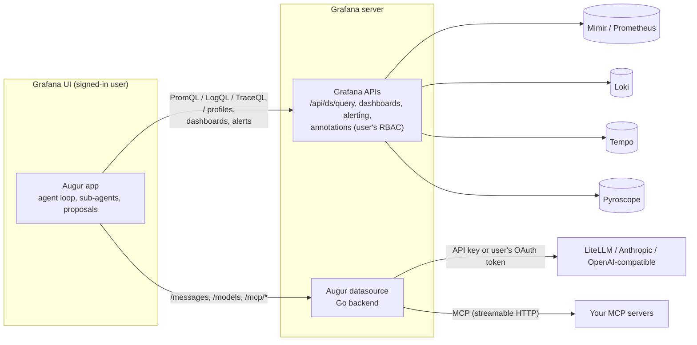

# How it works

## Two plugins

| Plugin | ID | Runs in | Role |
|---|---|---|---|
| Augur app | `augur-assistant-app` | The user's browser | UI and agent: page and sidebar, conversations, investigations, proposal cards, settings (rules, skills, memory). Holds no secrets. |
| Augur datasource | `augur-claude-datasource` | Grafana server (Go backend) | Model proxy (credentials, model allow-list, token cap, size limits, format translation) and MCP client. |

There are two plugins because Grafana forwards a user's OAuth token only to **datasource** plugins, and secrets should live on the server.

## The agent loop

The agent runs in the browser. Each step it sends the conversation and tool definitions to the model through the datasource, runs the tools the model asks for (Grafana API calls as the user, or MCP calls through the backend), and sends back summarised results, until the model answers or a budget is reached.

The agent code is UI-independent: tools take a `ToolContext` with an HTTP abstraction. The same code runs in the app, the [headless runner](../operate/headless.md) and the tests.

## Context management

Raw Grafana responses never reach the model. Tools summarise them in the browser first:

| Signal | What the model sees |
|---|---|
| Metrics | Per-series min/max/avg/last, peak time and ~12 downsampled samples; top 25 series by peak |
| Logs | Newest lines, near-duplicates collapsed into `[N× similar]` groups (IDs, numbers and timestamps normalised), long lines clipped to 400 characters, stream summary |
| Traces | Services, span count, error spans with status messages, and the 12 slowest spans with key attributes |
| Everything | Each tool result capped at ~14k characters, with a hint to narrow the query |

The conversation stays under a 140k-token budget (estimated conservatively). Older tool results are compacted in tiers, first to an excerpt and then to a one-line stub; the latest exchanges stay intact. If the gateway still reports *prompt too long*, Augur compacts harder and retries once. Prompt caching covers the system prompt, tools and latest turn.

## Durability

- The agent runs in a module-level store, not a React component, so runs **continue when you close the sidebar or navigate** within Grafana. The page and the sidebar are two views of the same run.
- The transcript is **checkpointed after every step** to local storage. After a reload or crash the conversation shows **Resume**, which continues from the checkpoint and re-runs unfinished tool calls.
- Transient gateway failures (sleep/wake, 429, 5xx, overloaded) are retried with backoff. The browser asks before you close a tab with a run in progress.
- **Leases** (one per conversation, 12 seconds) make sure only one tab drives a run; others take over if it goes away. Up to three conversations run at once.

Runs need an open Grafana tab. A server-side runner for scheduled and alert-triggered runs is on the roadmap.

## Knowing your Grafana

At the start of each run Augur reads the enabled plugins (`/api/plugins`) and the Grafana version, and tells the model which apps (Drilldown, SLO, IRM, k6, Asserts…), datasource types and panel types exist. Links point only to installed apps, and dashboards only use installed panel types.
